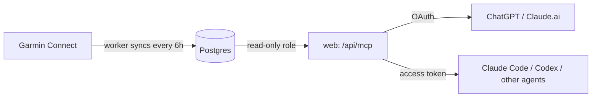

# health

Your Garmin data in a Postgres database you own, exposed to AI assistants (ChatGPT, Claude, Claude Code, Codex) through a read-only MCP server. Ask questions in plain language and the assistant writes the SQL.



## What it's for

- "How has my resting heart rate trended over the last 3 months?"
- "Do I sleep worse on days with high stress or late workouts?"
- "Compare my HRV in weeks with 3+ runs vs. weeks with fewer."
- "Give me a weekly recovery report: sleep, body battery, training readiness."
- "Which hours of the day am I most stressed on workdays?"

Everything runs on your machine. The assistant can only read; it cannot change or delete anything.

## Data

Synced from Garmin Connect each day (11 daily endpoints, plus activities):

| View | Granularity | Contents |
|---|---|---|
| `garmin.day` | daily | steps, distance, calories, resting/min/max HR, stress, body battery, intensity minutes, floors, SpO2, sleep duration/stages/score, HRV, training readiness |
| `garmin.halfday` | AM / PM | heart rate, stress, body battery, steps, respiration |
| `garmin.hourly` | hourly | same as above |
| `garmin.sample` | raw samples | `(ts, metric, value)`: heart rate (~2 min), stress (3 min), body battery, steps (15 min), respiration |
| `garmin.activities` | per workout | type, duration, distance, HR, training effect, load |

- Raw API responses are stored unchanged as `jsonb` in `garmin.daily(metric, day, data)` and `garmin.activity(id, start_time, data)`. The views above are projections, so new Garmin fields need no migration.
- Schema: [`db/schema.sql`](db/schema.sql). Agent guide: [`skills/health/SKILL.md`](skills/health/SKILL.md).
- Each sync re-fetches the last 2 days (watches upload late), plus any day in the last 14 that is still missing wellness data. The first sync backfills 30 days; pick an earlier date on the home page to backfill more.
- Times use the database timezone, taken from your browser when you connect Garmin.

**Privacy and safety**
- Your Garmin password is used once to obtain a login token and is never stored. The token lives in the database, in a table the read-only role cannot see.
- AI assistants query as `health_ro`: read-only transactions, a 30 s statement timeout, and no access to the login, session, or token tables.
- Postgres is not exposed outside Docker, and the web app listens on `127.0.0.1` only. All passwords and secrets are randomly generated on first start.

## Install

### With a coding agent (recommended)

Give your coding agent (Claude Code, Codex, Cursor, …) this prompt:

> Clone https://github.com/lincleejun/health and install it by following INSTALL.md.

[INSTALL.md](INSTALL.md) is written for agents: it checks prerequisites, starts the stack, verifies it, fixes common problems, and tells you what to click.

### By hand

Requires Docker (Docker Desktop, OrbStack, or Docker Engine with Compose v2).

```bash
git clone https://github.com/lincleejun/health.git && cd health
docker compose up -d --wait
```

The first build takes a few minutes; the command returns once everything is up. Then open http://localhost:3000 and:

1. **Sign up.** The first account becomes the owner, and sign-up closes after that.
2. **Connect Garmin** with your Garmin email and password. Two-factor codes are supported.
3. **Create an access token** and connect your AI assistant (see below).

No configuration is needed. Optional settings go in a `.env` file next to `docker-compose.yml`:

| Variable | Default | Purpose |
|---|---|---|
| `HEALTH_PORT` | `3000` | Local port (bound to 127.0.0.1) |
| `PUBLIC_URL` | `http://localhost:3000` | Public HTTPS URL, needed for ChatGPT / Claude.ai |
| `SYNC_INTERVAL_HOURS` | `6` | How often to sync Garmin |

## Connect an AI assistant

**Claude Code, Codex, and other local agents.** Create a token on the home page. The page shows a ready-to-paste command:

```bash
claude mcp add --transport http health http://localhost:3000/api/mcp --header "Authorization: Bearer <token>"
```

Or skip tokens and use stdio through Docker:

```bash
claude mcp add health -- docker compose -f /path/to/health/docker-compose.yml exec -T worker entrypoint.sh python health.py mcp
```

**ChatGPT and Claude.ai** connect from the cloud, so they need a public HTTPS URL that forwards to port 3000. A reverse proxy, Cloudflare Tunnel, or Tailscale Funnel all work. Then restart with that URL:

```bash
PUBLIC_URL=https://health.example.com docker compose up -d
```

- **ChatGPT:** Settings → Apps & Connectors → add a custom MCP server. Use URL `https://health.example.com/api/mcp` with OAuth, then sign in and allow "View health data".
- **Claude.ai:** Settings → Connectors → add a custom connector with the same URL.

The MCP server has two tools: `schema()` lists tables and views with descriptions, and `query(sql)` runs read-only SQL.

## Operate

```bash
docker compose logs -f worker                                   # sync logs
docker compose up -d --build                                    # update after git pull
docker compose exec db pg_dump -U health health > backup.sql    # back up
docker compose down                                             # stop (data is kept in the "db" volume)
```

## Alternative deployment: Vercel + Neon + GitHub Actions

This setup needs no always-on machine:

- **Database:** Neon. Put `DATABASE_URL` (owner) and `DATABASE_URL_RO` (`health_ro`) in `.env`, and optionally `HEALTH_TZ`. Run `uv run health.py init-db`, then `cd web && npm run db:init`.
- **Web:** deploy `web/` to Vercel with `DATABASE_URL`, `DATABASE_URL_RO`, and `BETTER_AUTH_SECRET`. Leave `WORKER_URL` unset; the Garmin section on the home page is then hidden.
- **Garmin login:** run `uv run health.py garmin-login` locally. The token is saved to the database. Run it again if the token ever expires.
- **Sync:** [`.github/workflows/garmin-sync.yml`](.github/workflows/garmin-sync.yml) runs daily at 15:00 UTC with one secret, `DATABASE_URL`. To backfill, go to Actions → garmin-sync → Run workflow and enter a `since` date.
- **Local stdio MCP:** `claude mcp add -s user health -- uv --directory /path/to/health run health.py mcp`.

## Notes

- Garmin access uses the unofficial [`python-garminconnect`](https://github.com/cyberjunky/python-garminconnect) library. Garmin may change or rate-limit it.
- Single user per installation.
- Not medical advice. The assistant is told to report numbers and sample sizes, not diagnoses.
- Planned: Oura, nutrition.

## License

[MIT](LICENSE)
